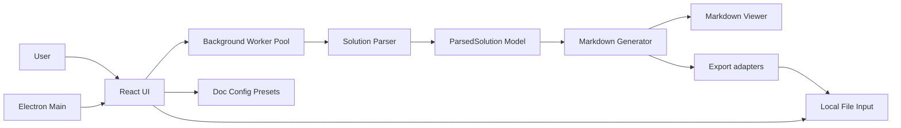
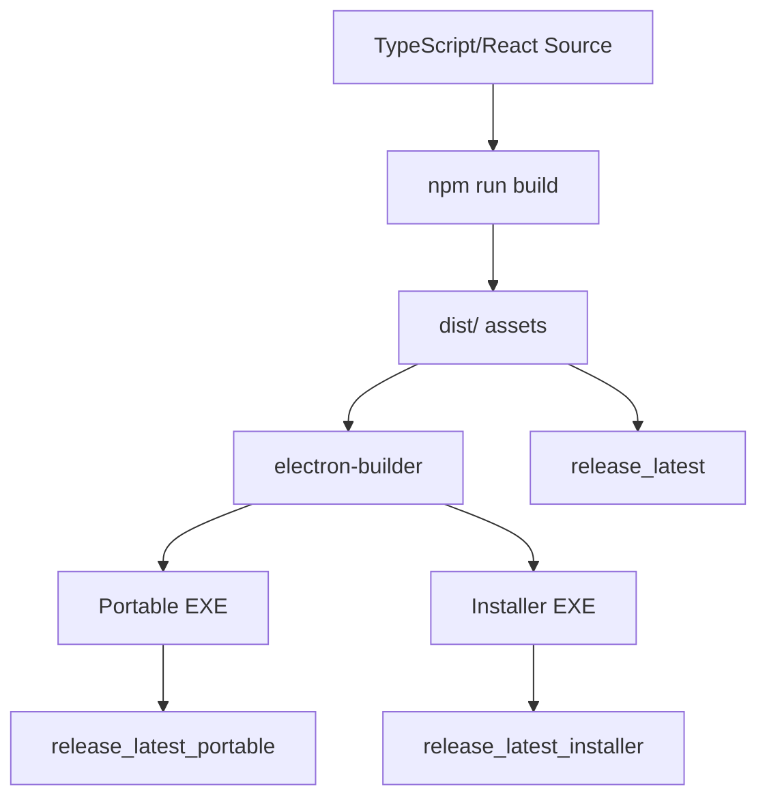

# PP-MD High-Level Design

## Local-File Parity

PP-MD retains its standalone Electron shell and local ZIP parser. No connected Dataverse collectors or ToolBox bridge are introduced. A complete All Selected Solutions document accompanies the existing consolidated summary. Matching peer metadata fills gaps without broadening individual top-level inventories; manifest prerequisites retain their source solution.

Portable export adapters produce sanitised standalone HTML, searchable PDF with diagram images and source fallbacks, and packaged Excel workbooks with native tables and frozen panes. Installation guides support both Markdown and sectioned Excel. A shared download layer handles safe filenames, collisions, category folders, progress and cancellation. Diagnostics remain separate from normal documentation. CPU-intensive parsing is distributed across a bounded worker pool with compatibility fallback. The diagram renderer schedules background work with visible-first ordering, validates SVG output, and retains a 100-entry LRU cache.

The selected solution set is also passed to a reusable offline installation planner. It derives provider-first steps, readiness layers, blocker propagation, missing prerequisites, strongly connected cycle groups, downstream waiters and component evidence once; Markdown and Excel render that same model so the two outputs remain consistent.

See [local-file parity](local-file-parity.md) for capability boundaries, exclusions, and verification requirements.

## Overview
PP-MD is a Windows desktop documentation generator for Microsoft Power Platform solutions. The application ingests one or more solution ZIP archives, parses Dataverse and solution metadata, and generates human-readable markdown documentation with Mermaid diagrams.

## Goals
- Convert Power Platform solution content into structured technical documentation.
- Provide a desktop-first workflow for consultants and delivery teams.
- Keep generated output portable and editable as markdown.
- Preserve accessibility and security baselines in the UI/runtime.

## Architectural Style
- Client-heavy, local-processing architecture.
- Electron shell hosting a React + TypeScript renderer.
- Worker-backed local parsing and application-side markdown generation (no backend service).
- Layered modules:
  - Presentation layer (React components and CSS modules)
  - Application orchestration layer (App.tsx)
  - Domain processing layer (solutionParser.ts, markdownGenerator.ts)
  - Worker coordination layer (src/workers)
  - Export adapters (HTML, PDF, Excel and OOXML packaging)
  - Packaging/runtime layer (Electron main process and build scripts)

## Context Diagram

## Major Components

### Electron Desktop Host
- main process window creation and lifecycle
- packaged-vs-dev loading behavior
- secure renderer defaults (context isolation, sandbox)
- open external links in default system browser

### React Renderer UI
- drag/drop and browse intake for solution ZIP files
- processing progress and status feedback
- multi-solution navigation and selection
- markdown view, copy, and export actions
- theme selection and persistence

### Parsing Engine
- unzips and reads solution.xml/customizations.xml and related artifacts
- normalizes varied XML schemas and label formats
- emits strongly-typed ParsedSolution object
- records manifest component types, schema/parent identities, packages and dependency evidence
- runs with cancellation-aware progress and a bounded two-worker concurrency model

### Markdown Engine
- transforms ParsedSolution into sectioned markdown
- creates inventory tables and process details
- emits Mermaid ERD and architecture diagrams
- supports consolidated multi-solution report generation
- produces dependency reports and provider-first installation guidance

### Export Engine
- creates sanitised standalone HTML and searchable PDF
- creates Excel solution workbooks with native Excel tables, frozen headers, navigation and overflow continuations
- exports installation-guide sections to dedicated worksheets
- handles safe names, collisions, batch ZIP paths, progress and cancellation

### Build and Packaging Pipeline
- Vite + TypeScript frontend build
- Electron Builder packaging to portable and installer targets
- post-build mirroring to latest artifact folders

## Data Flow
1. User selects one or more .zip files in the drop zone.
2. App orchestration passes ZIP buffers to the worker pool (up to two active parses) and falls back locally if the host cannot run workers.
3. ParsedSolution objects are passed to generateMarkdown.
4. Generated markdown is displayed in MarkdownViewer.
5. User exports one or more documents as Markdown, HTML, PDF or Excel to local storage.
6. Optional consolidated markdown is generated across all loaded solutions.

## Technology Stack
- Runtime shell: Electron 45
- Frontend: React 19 + TypeScript 6 + Vite 8
- Toolchain runtime: Node.js 24 + npm 12
- Parsing: JSZip + fast-xml-parser
- Rendering: react-markdown + remark-gfm + Mermaid
- Background processing: inline Web Workers
- Excel: xlsx-js-style plus PP-MD OOXML packaging
- Packaging: electron-builder + PowerShell automation

## Security and Safety Posture
- Local-only processing of source ZIPs (no server upload path).
- CSP in index.html with restricted default sources.
- Electron security options enabled: contextIsolation and sandbox.
- External links blocked from opening new in-app windows.
- XML parser configured to avoid entity-expansion style attacks.

## Accessibility Baseline
- Keyboard-accessible controls and navigation landmarks.
- ARIA status/progress announcements.
- Contrast token checks enforced by script during build.
- Diagram source fallback to support non-visual consumption.

## Deployment View

## Operational Modes
- Development mode:
  - Vite dev server + Electron shell (desktop:dev)
  - detached dev tools enabled
- Packaged mode:
  - loads static dist/index.html
  - displays fatal load/crash error dialogs when needed

## Constraints and Assumptions
- Input format depends on Microsoft solution ZIP structure.
- Parsing logic includes defensive fallbacks due to XML shape variability.
- Diagram richness can increase markdown rendering cost on very large solutions.
- Windows-focused packaging pipeline and output naming conventions.
